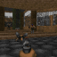

# ivdoom

DOOM on a real **Pixoo 64** panel (64×64 WS2812 matrix), driven by a **phone** over the LAN.

One Node process. The controller page, the input broker, the status-strip cache, the panel supply loop and the
headless engine all run in the same PID — no Azure Functions host, no TLS forwarder, no second service. The one
subprocess that stays is the game itself: a C binary (`doomgeneric` + a `dg_stdio.c` shim) fed key lines on
stdin and read back as raw frames on fd 3.


 
> **What that file is, exactly** — because "it's a demo GIF" hides everything worth knowing about it:
> `assets/doom-demo-60s-24fps-1.gif`, 64×64, **60.00 s**, GIF delays of 40 ms and 50 ms written per frame
> (1440 frames; 1433 after the GIF writer merged consecutive identical frames and summed their delays, which
> preserves the total). Made by `yarn demo:gif` from the engine's own `-playdemo DEMO1` path, starting 3 s in,
> with the 320×200 frame centred-cropped and box-filtered to 64×64 — the same crop the panel gets.
> **It plays at 0.69× game speed**: 1440 consecutive frames are 41.1 s of demo time at DOOM's fixed 35 tics/s,
> shown over 60.00 s. Real time at 24 fps would mean dropping engine frames, and this repo does not do that:
> the sequence it captures is the sequence the engine produced. 5 308 239 bytes.
>
> **Shown at `width="512"`, from a 64 px file.** That attribute is the only enlargement GitHub's renderer
> keeps: measured against its own output, `width` survives while `style` (including `image-rendering`, `zoom`,
> `transform`), `class` and `srcset` are all stripped and replaced by GitHub's own `max-width:100%` ceiling.
> So the 8× here is the browser's interpolation, not this repo's choice — see *Measured in this repo* in
> `AGENTS.md` for the ladder, and for the byte cost of baking the pixels instead (128 px = 11 117 631 B up to
> 512 px = 57 478 525 B, which is why the file stays 64×64).

## Run it

```bash
yarn install
yarn engine   # clone doomgeneric + make → .gener/build/doom/doom-headless (needs gcc)
yarn cert     # .gener/devcert/{dev.crt,dev.key}; SAN from os.networkInterfaces(), never hard-coded
yarn play     # page + broker + hud + engine + panel, one command
```

`yarn play` then prints the URL the phone should open, e.g. `https://192.168.1.16:8443/api/doom/ui/` — install
`dev.crt` as a CA on the phone first, or you get a certificate warning (and no install option).

Everything else: `yarn play:32`, `yarn play:demo` (no phone), `yarn serve` (page only, no engine, no panel),
`yarn host:check`, `yarn canary`, `yarn demo:gif`, `yarn kill` — see `package.json`, and [AGENTS.md](AGENTS.md)
for what each one is for.

## How it is shaped

| | |
|---|---|
| `scripts/doom-device.cjs` | the entry point: args → start the host → build the engine argv → spawn → frames from fd 3 → crop+scale → push to the panel → `Ctrl-C` releases every key and closes the engine **then** the host |
| `src/host/server.ts` | `node:https` when `.gener/devcert` exists, else `node:http`. Own port (8443 / 8080). TLS is terminated **here**, because a certificate only helps if it is valid for the address the phone types |
| `src/http/handlers.ts` | every route: `/ui/`, `/input`, `/input/state`, `/input/sessions`, `/hud`, `/hud/state`, `/hud/image`, `/version` |
| `src/input/` | the broker between phone and player. A held stick is a **level** (held until released); taps are **edges** carried to a cursor. Phone and engine read the same session |
| `src/game/` | phone frame → engine key lines; engine frames → the panel's 64×64 or 32×32 |
| `src/hud/` | the status strip (score, keys, HP) as a PNG the player can GET: a 64×64 panel cannot show it, a phone can |
| `src/pixoo/` | panel client + the only authority on PicSpeed/post pacing milliseconds |
| `scripts/doom/` | the engine build (`Makefile`, `dg_stdio.c`): fd 0 in, fd 3 `DG_FRAME`/`DG_EVENT` out |

The phone page derives its own API root from the URL it was served from, so **whatever serves the page must
own `/input` and `/hud`**. That single same-origin rule is the reason the server is inside this process
instead of being a second service in front of it.

## What is proven, and what is not

`yarn host:check` proves, over real HTTP against the same module the game starts, that one PID answers every
route (asserted by comparing `/version`'s own `pid` with the caller's), that a posted stick is held as a level
until a release clears it, and that a status strip posted by the production producer comes back byte-identical
with the same sequence. `yarn demo:gif` output was re-read from the file it wrote rather than trusted from the
generator's own log — and that is how the 10 ms GIF-unit bug in `exactDelays` was found: the first 60 s run
reported `24.00 fps` and the file was really 57.6 s.

Not proven here, and deliberately not "fixed": whether **Android Chrome offers "Install app"** on your phone
(it needs the phone), and whether 64×64 is playable on the panel (only 32×32 has been measured playable;
the default stage `--warp 1 2` is a dark map, mean luma ≈36). Details and the open questions are in
[AGENTS.md](AGENTS.md).

## Notes

- `local.settings.json` holds `PIXOO_ORIGIN` — your panel's LAN address — and nothing else. `.gener/` is
  gitignored: the engine source, the 28 MB WAD, the build and the dev cert are all reproducible from the two
  commands above.
- There is **no shared layer** with the dashboard this was split out of (`../pixoo`): no `file:../pixoo`, no
  third package. `src/input`, `src/pixoo`, `src/hud`, `src/ui` and `resources/ui` are copies here, so they can
  drift — the pacing numbers in `src/pixoo/pacing.ts` are this repo's to change.
- The GIF in `assets/` is committed on purpose: a README with no picture is a claim about what the thing looks
  like.
