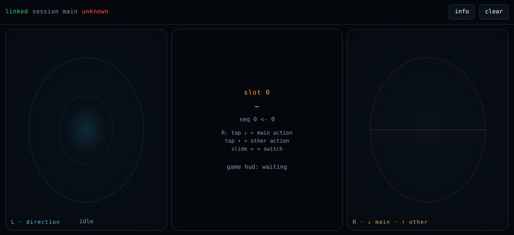

# ivdoom

DOOM **runs here, in Node.js**. The game engine is **[doomgeneric](https://github.com/ozkl/doomgeneric)**:
`yarn engine` clones it into `.gener/vendor/doomgeneric` and `scripts/doom/Makefile` builds it with our own
`scripts/doom/dg_stdio.c` shim into `.gener/build/doom/doom-headless`, which is spawned as a **child process**
of this repo's Node process and plays **FreeDOOM 1** (`freedoom1.wad`). Its 320×200 frames are scaled down by
this process and pushed over the LAN to a real **Pixoo 64** panel (64×64 WS2812 matrix).

The controls come from a **phone** — the virtual-gamepad PWA that this same process serves. The phone never runs
DOOM: it posts a stick **level** and key **edges** to the broker, and reads back a status strip that a 64×64
panel cannot show.

One Node process. The controller page, the input broker, the status-strip cache, the panel supply loop and the
headless engine all run in the same PID — no Azure Functions host, no TLS forwarder, no second service. The one
subprocess that stays is the game itself: a C binary (`doomgeneric` + a `dg_stdio.c` shim) fed key lines on
stdin and read back as raw frames on fd 3.


 
> **What that file is, exactly** — because "it's a demo GIF" hides everything worth knowing about it:
> `assets/doom-demo-60s-24fps-1.gif`, 64×64, **60.00 s**, GIF delays of 40 ms and 50 ms written per frame
> (1440 frames; 1433 after the GIF writer merged consecutive identical frames and summed their delays, which
> preserves the total). Made by `yarn demo:gif` from the engine's own `-playdemo DEMO1` path, starting 3 s in,
> with the 320×200 frame centred-cropped and box-filtered to 64×64 — the same crop the panel gets.
> **It plays at 0.69× game speed**: 1440 consecutive frames are 41.1 s of demo time at DOOM's fixed 35 tics/s,
> shown over 60.00 s. Real time at 24 fps would mean dropping engine frames, and this repo does not do that:
> the sequence it captures is the sequence the engine produced. 5 308 239 bytes.
>
> **Shown at `width="512"`, from a 64 px file.** That attribute is the only enlargement GitHub's renderer
> keeps: measured against its own output, `width` survives while `style` (including `image-rendering`, `zoom`,
> `transform`), `class` and `srcset` are all stripped and replaced by GitHub's own `max-width:100%` ceiling.
> So the 8× here is the browser's interpolation, not this repo's choice — see *Measured in this repo* in
> `AGENTS.md` for the ladder, and for the byte cost of baking the pixels instead (128 px = 11 117 631 B up to
> 512 px = 57 478 525 B, which is why the file stays 64×64).

## The controller — the phone's entire interface



> That page was served by `node scripts/doom-device.cjs --host-only --port 8091` with **no engine and no panel
> attached**, so the pads are live to the broker while the strip honestly says `game hud: waiting`. The file is
> 1920×880 because it was captured in headless Chromium at a **960×440 CSS viewport with `deviceScaleFactor: 2`**
> — the two-thumb layout a landscape phone gets, rasterised at 2× (269 493 B). Asking for `width="960"` here
> makes the browser **downscale** it 2:1, which is the direction that stays sharp without any CSS. `zoom: 2` was
> tried first and clipped the picture: this page sizes itself in `vh`, so zooming it makes it taller than the
> viewport.

## Run it

```bash
yarn install
yarn engine   # clone doomgeneric + make → .gener/build/doom/doom-headless (needs gcc)
yarn cert     # .gener/devcert/{dev.crt,dev.key}; SAN from os.networkInterfaces(), never hard-coded
yarn play     # page + broker + hud + engine + panel, one command
```

`yarn play` then prints the URL the phone should open, e.g. `https://IPorHost:8043/api/doom/ui/` — install
`dev.crt` as a CA on the phone first, or you get a certificate warning (and no install option).

Everything else: `yarn play:32`, `yarn play:demo` (no phone), `yarn serve` (page only, no engine, no panel),
`yarn host:check`, `yarn canary`, `yarn demo:gif`, `yarn kill` — see `package.json`, and [AGENTS.md](AGENTS.md)
for what each one is for.

## How it is shaped

| | |
|---|---|
| `scripts/doom-device.cjs` | the entry point: args → start the host → build the engine argv → spawn → frames from fd 3 → crop+scale → push to the panel → `Ctrl-C` releases every key and closes the engine **then** the host |
| `src/host/server.ts` | `node:https` when `.gener/devcert` exists, else `node:http`. Own port (`DEFAULT_TLS_PORT` 8043 / `DEFAULT_HTTP_PORT` 8000 — not 8443/8080: 8080 is held by another runtime on the machine this is developed on, and `--port <n>` overrides it). TLS is terminated **here**, because a certificate only helps if it is valid for the address the phone types |
| `src/http/handlers.ts` | every route: `/ui/`, `/input`, `/input/state`, `/input/sessions`, `/hud`, `/hud/state`, `/hud/image`, `/version` |
| `src/input/` | the broker between phone and player. A held stick is a **level** (held until released); taps are **edges** carried to a cursor. Phone and engine read the same session |
| `src/game/` | phone frame → engine key lines; engine frames → the panel's 64×64 or 32×32 |
| `src/hud/` | the status strip (score, keys, HP) as a PNG the player can GET: a 64×64 panel cannot show it, a phone can |
| `src/pixoo/` | panel client + the only authority on PicSpeed/post pacing milliseconds |
| `scripts/doom/` | the engine build (`Makefile`, `dg_stdio.c`): fd 0 in, fd 3 `DG_FRAME`/`DG_EVENT` out |

The phone page derives its own API root from the URL it was served from, so **whatever serves the page must
own `/input` and `/hud`**. That single same-origin rule is the reason the server is inside this process
instead of being a second service in front of it.

## What is proven, and what is not

`yarn host:check` proves, over real HTTP against the same module the game starts, that one PID answers every
route (asserted by comparing `/version`'s own `pid` with the caller's), that a posted stick is held as a level
until a release clears it, and that a status strip posted by the production producer comes back byte-identical
with the same sequence. `yarn demo:gif` output was re-read from the file it wrote rather than trusted from the
generator's own log — and that is how the 10 ms GIF-unit bug in `exactDelays` was found: the first 60 s run
reported `24.00 fps` and the file was really 57.6 s.

Not proven here, and deliberately not "fixed": whether **Android Chrome offers "Install app"** on your phone
(it needs the phone), and whether 64×64 is playable on the panel (only 32×32 has been measured playable;
the map that measurement was taken on (E1M2) is a dark one, mean luma ≈36; which stage and width the scripts
ask for live in `package.json` and are edited there). Details and the open questions are in
[AGENTS.md](AGENTS.md).

## Notes

- `local.settings.json` holds `PIXOO_ORIGIN` — your panel's LAN address — and nothing else. `.gener/` is
  gitignored: the engine source, the 28 MB WAD, the build and the dev cert are all reproducible from the two
  commands above.
- There is **no shared layer** with the dashboard this was split out of (`../pixoo`): no `file:../pixoo`, no
  third package. `src/input`, `src/pixoo`, `src/hud`, `src/ui` and `resources/ui` are copies here, so they can
  drift — the pacing numbers in `src/pixoo/pacing.ts` are this repo's to change.
- The GIF and the controller PNG in `assets/` are committed on purpose: a README with no picture is a claim
  about what the thing looks like.
- `yarn serve` and `yarn play` bind `8000` (plain) or `8043` (when a dev cert exists), and `yarn kill` frees
  exactly those two. They are **not** 8080/8443: on this machine 8080 belongs to another runtime, and a busy
  port is answered with both possible causes named (our previous run, or a program that is not ivdoom). In the
  second case `--port <n>` moves this run — measured: `node scripts/doom-device.cjs --host-only --port 8091`
  served `/api/doom/ui/` 200 while another program held 8080.
- **A machine whose firewall is on needs a rule for whichever port you use** (`grep ENABLE /etc/ufw/ufw.conf`
  says `ENABLED=yes` on this one):
  ```bash
  sudo ufw allow from 192.168.0.0/16 to any port 8000 proto tcp comment 'ivdoom page http  -> LAN devices'
  sudo ufw allow from 192.168.0.0/16 to any port 8043 proto tcp comment 'ivdoom page https -> LAN devices'
  ```
  Hand-editing `/etc/ufw/user.rules` needs `sudo ufw reload` to take effect; `sudo ufw status numbered` is how
  you check it. A phone still failing after that is *not* proof the rule is wrong — check `ss -ltnp` first: on
  2026-10-12 the phone was refused at a moment when nothing was listening (the run had died on the old port).
  And without a dev cert the page is plain HTTP: type `http://`, not `https://`.

## Development

The DOOM integration, the single-process host, the probe/check scripts and the fixes in this repo were produced
by an agent workflow, not typed by hand: **`flash-3.8-flash-next-iq3_xxs` (Strata)** and **
[Gener](https://marketplace.visualstudio.com/items?itemName=tommyli.gener)**, a VS Code extension, did the
spawning of the engine, the reading of its fd 3 output, and the re-reading of every file they wrote.

Read the claims in that light: each number in [AGENTS.md](AGENTS.md) came from running the shipped code and
asserting on its output, and anything that could not be checked here — whether Chrome offers *Install app* on
your phone, whether 64×64 is playable on your panel — is listed under *NOT proven/what is not* instead of being
quietly asserted.
